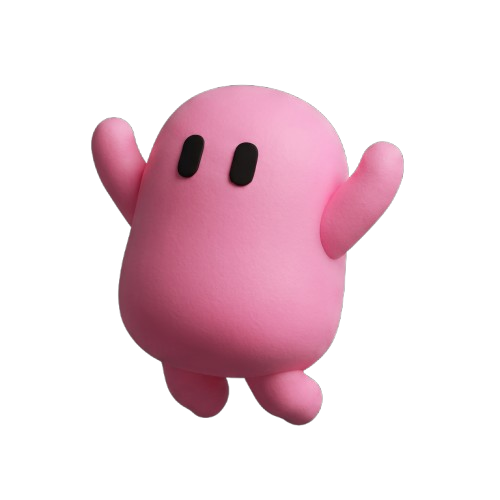

<p align="center">
  
</p>

# Guia de Marca — Tina

**Status:** Especificação de design | **Fase:** 1 — Desktop Inicial
**Fonte de verdade do código:** `src-frontend/src/theme.css` e `src-frontend/src/lib/components/`

---

## 1. A personagem

Tina é uma criatura rosa de corpo arredondado e macio, sem boca, com dois olhos
ovais pretos, dois bracinhos erguidos e dois pés curtos. A arte oficial a mostra
flutuando, em pose alegre. Ela é a mascote do produto e a identidade visual
vinculada a ele — aparece no cabeçalho, dentro das telas e no ícone do aplicativo.

| Atributo | Regra |
|---|---|
| Cor da personagem | Rosa (`#ee6495` na paleta). Nunca recolorir. |
| Olhos | Dois ovais pretos, expressão neutra e amigável. Não adicionar boca. |
| Pose | Bracinhos erguidos, flutuando. Não espelhar, girar ou cortar membros. |
| Estilo | Volume 3D suave, tipo massinha. Não achatar, aplicar contorno ou sombra dura. |
| Fundo | Transparente na arte; sempre sobre branco ou rosa claro. |

**Não faça:** substituir por emoji, letra "T", ícone genérico de robô, ou gerar uma
nova mascote. A arte é fornecida pelo proprietário e é a única aprovada.

---

## 2. Arquivos oficiais

| Asset | Caminho | Papel |
|---|---|---|
| Arte da personagem | `src-frontend/static/tina.png` | Logo do cabeçalho (`Logo`), mascote das telas, favicon (`/tina.png`) |
| Ícone do app (512) | `src-tauri/icons/icon.png` | Ícone mestre do tile |
| Ícone Windows | `src-tauri/icons/icon.ico` | **Obrigatório** para o `tauri-build`; sem ele o build quebra |
| Tamanhos do bundle | `src-tauri/icons/16x16.png` … `256x256.png`, `128x128@2x.png` | Listados em `src-tauri/tauri.conf.json` |
| Favicon web | `src-frontend/static/favicon.ico` | Evita `404 /favicon.ico` na janela Tauri |

Nenhum asset novo de mascote entra sem decisão registrada do proprietário e entrada
em `docs/provenance/REGISTER.md`.

---

## 3. Uso do logo

### 3.1 Construção do tile

O ícone é a personagem dentro de um tile quadrado de cantos arredondados:

| Propriedade | Valor |
|---|---|
| Fundo | Gradiente `#fff7fa` → `#ffe2ed` (135°) |
| Borda | `1px` `#ffc7db` |
| Raio | `0.28 × tamanho do logo` |
| Arte | `88%` do tile, `object-fit: contain`, centralizada |
| Sombra | `0 8px 18px rgba(208, 115, 146, 0.28)` |

A arte interna mantém ~70% da altura do tile, com respiro igual nos quatro lados.

### 3.2 Tamanhos em uso

| Contexto | Tamanho | Onde |
|---|---|---|
| Logo do cabeçalho | `3.75rem` (60px) | `<Logo />` em `+page.svelte` |
| Mascote na tela | `7.5rem` (120px) | `.mascot` no bloco `.intro` |
| Mascote em telas estreitas (≤640px) | `5.5rem` (88px) | `@media (max-width: 640px)` |
| Favicon da janela | 16–32px | Tile simplificado, sem texto |

**Mínimo digital:** 24px para o tile completo. Abaixo disso, use o `.ico` do bundle.

### 3.3 Área de respiro

Reserve no mínimo **25% da altura do logo** livre em todos os lados. Nenhum texto,
borda de card ou outro ícone encosta nessa margem.

### 3.4 Fundos permitidos

| Fundo | Permitido | Observação |
|---|---|---|
| Branco `#ffffff` | Sim | Preferencial |
| Rosa claro `#fff7fa` / `#ffe9f1` | Sim | Usado no `.intro` e nos cards |
| Cores saturadas / fotos / escuro | Não | A personagem perde contraste e identidade |

### 3.5 Faça e não faça

| Faça | Não faça |
|---|---|
| Usar `Logo.svelte` com `size` para escalar | Redimensionar a `` direto na página |
| Manter a proporção 1:1 do tile | Esticar, achatar ou girar a arte |
| Deixar a personagem flutuar com a animação padrão | Adicionar giro, bounce ou tremor |
| Usar a arte oficial em qualquer superfície | Trocar por outro desenho ou emoji |

---

## 4. Paleta

Fonte: `src-frontend/src/theme.css`. Use sempre `var(--tina-*)`; hex solto em
componente novo é proibido.

### 4.1 Cores de marca

| Token | Hex | Uso |
|---|---|---|
| `--tina-pink` | `#ee6495` | Cor principal: botões, focos, destaques |
| `--tina-pink-strong` | `#d94f80` | Fim do gradiente do botão, hover |
| `--tina-pink-bright` | `#ee9ec1` | Detalhes e brilhos |
| `--tina-pink-soft` | `#f7a8c4` | Borda esquerda do `.intro`, detalhes |
| `--tina-pink-deep` | `#c9266b` | Texto de ênfase sobre branco |

### 4.2 Superfícies

| Token | Hex | Uso |
|---|---|---|
| `--tina-bg` / `--tina-surface` | `#ffffff` | Fundo da página e dos cards |
| `--tina-surface-tint` | `#fff7fa` | Chips, `code`, badge padrão, pill |
| `--tina-surface-pink` | `#ffe9f1` | Badge ativo, fim do gradiente suave |

### 4.3 Bordas e texto

| Token | Hex | Uso |
|---|---|---|
| `--tina-border` | `#ffe0ec` | Borda padrão de card e chip |
| `--tina-border-strong` | `#ffc7db` | Borda em destaque e hover de card |
| `--tina-border-glow` | `#ffc7db` | Borda do tile do logo |
| `--tina-text` | `#4b2b36` | Texto principal |
| `--tina-title` | `#3f2029` | Títulos (`h1`) |
| `--tina-text-muted` | `#7a5a66` | Texto secundário, parágrafos |
| `--tina-text-soft` | `#a0838e` | Rodapé, metadados |
| `--tina-text-pink` | `#c2416f` | `code`, pill, links |
| `--tina-text-pink-soft` | `#b8638a` | Eyebrow (rótulo acima do título) |
| `--tina-text-on-pink` | `#ffffff` | Texto sobre botão rosa |

### 4.4 Gradientes

| Token | Valor |
|---|---|
| `--tina-gradient-page` | `radial-gradient(circle at 50% -10%, #fff2f7 0%, #ffffff 55%)` |
| `--tina-gradient-soft` | `linear-gradient(135deg, #fff7fa 0%, #ffe9f1 100%)` |
| `--tina-gradient-logo` | `linear-gradient(135deg, #fff7fa 0%, #ffe2ed 100%)` |
| `--tina-gradient-button` | `linear-gradient(135deg, #ee6495 0%, #d94f80 100%)` |

### 4.5 Contraste (WCAG)

| Combinação | Razão | Situação |
|---|---|---|
| `--tina-text` sobre branco | ≈12,4:1 | AAA |
| `--tina-text-muted` sobre branco | ≈6,1:1 | AA |
| `--tina-pink-deep` sobre branco | ≈5,3:1 | AA |
| Branco sobre `--tina-pink` | ≈3,1:1 | Só texto grande (≥18,66px bold ou 24px) |

> **Pendência conhecida:** o rótulo do `Button` usa `0.85rem` (13,6px) em branco sobre
> o gradiente rosa, abaixo do mínimo AA de 4,5:1. Ao criar botões com texto pequeno,
> prefira `--tina-pink-deep` sobre fundo claro ou aumente o texto para o limiar de
> "texto grande". A correção do componente deve ser decidida pelo proprietário, não
> aplicada silenciosamente em outra tarefa.

---

## 5. Tipografia

| Token | Valor |
|---|---|
| `--tina-font` | `'Segoe UI', system-ui, -apple-system, sans-serif` |
| `--tina-font-mono` | `Consolas, 'Cascadia Code', monospace` |

| Papel | Tamanho | Peso | Extras |
|---|---|---|---|
| Eyebrow | `0.72rem` | 600 | `letter-spacing: 0.14em`, maiúsculas |
| Título `h1` | `1.8rem` | 700 | `line-height: 1.2`, `letter-spacing: -0.01em` |
| Título de card `h2` | `0.95rem` | 600 | Cor `#8d6b78` |
| Corpo | `1rem` | 400 | `line-height: 1.6–1.65` |
| Valor em destaque | `1.05rem` | 500 | `line-height: 1.4` |
| Detalhe | `0.85rem` | 400 | `line-height: 1.55` |
| Caminho/`code` | `0.82–0.85em` | 400 | Fonte mono, `word-break: break-all` |
| Rodapé | `0.82rem` | 400 | `line-height: 1.6` |

---

## 6. Espaçamento

Escala base de **0,25rem** (4px): `0.25 · 0.5 · 0.75 · 1 · 1.25 · 1.5 · 2 · 2.5 · 3`.
Não introduza valores fora da escala sem necessidade demonstrada.

| Contexto | Valor |
|---|---|
| Container `main` | `max-width: 1060px`, `padding: 2.5rem 2rem 3rem` |
| Cabeçalho | `margin-bottom: 2rem`, `gap: 1rem` |
| Bloco `.intro` | `gap: 1.5rem`, `padding: 1.4rem 1.3rem 1.4rem 1.4rem`, `margin-bottom: 1.25rem` |
| Grade de cards | `gap: 1rem`, colunas `minmax(260px, 1fr)` |
| Card | `padding: 1.35rem`, `gap: 0.75rem`, `min-height: 190px` |
| Rodapé | `margin-top: 2rem`, `padding-top: 1rem` |

---

## 7. Raios e sombras

| Token | Valor | Uso |
|---|---|---|
| `--tina-radius-sm` | `0.35rem` | `code`, chips pequenos |
| `--tina-radius-md` | `0.75rem` | Elementos internos |
| `--tina-radius-lg` | `1rem` | Cards e `.intro` |
| `--tina-radius-pill` | `999px` | Badge, pill, botão |
| Logo | `calc(0.28 * var(--logo-size))` | Tile do logo |

| Token | Valor |
|---|---|
| `--tina-shadow-logo` | `0 8px 18px rgba(208, 115, 146, 0.28)` |
| `--tina-shadow-card` | `0 6px 18px rgba(208, 115, 146, 0.08)` |
| `--tina-shadow-card-hover` | `0 10px 26px rgba(208, 115, 146, 0.16)` |
| `--tina-shadow-button` | `0 6px 14px rgba(217, 79, 128, 0.28)` |
| Mascote | `drop-shadow(0 14px 18px rgba(208, 115, 146, 0.28))` |

Sombras são sempre rosadas e difusas. Nunca use sombra preta ou dura.

---

## 8. Componentes

Todos em `src-frontend/src/lib/components/`. Reutilize; não reimplemente estilo na
página.

### 8.1 `Logo`

```svelte
<Logo size="3.75rem" alt="Tina" />
```

| Prop | Tipo | Padrão | Regra |
|---|---|---|---|
| `size` | `string` | `3.75rem` | Escala o tile; raio acompanha |
| `alt` | `string` | `Tina` | Use `""` só quando a imagem for decorativa e já houver texto |

### 8.2 `Card`

```svelte
<Card title="Banco local">
  {#snippet badge()}
    <Badge tone="ok">pronto</Badge>
  {/snippet}
  <p class="value">…</p>
  <p class="detail">…</p>
  <Button onclick={acao}>Verificar</Button>
</Card>
```

| Prop | Tipo | Regra |
|---|---|---|
| `title` | `string` | Obrigatório; vira `h2` |
| `badge` | `Snippet` | Opcional; alinhado à direita do título |
| `children` | `Snippet` | Corpo; entra direto no flex do card (`display: contents`) |

O corpo do card é um flex vertical com `gap: 0.75rem`. O botão usa `margin-top: auto`
para ancorar no rodapé do card.

### 8.3 `Badge`

```svelte
<Badge tone="default">aguardando</Badge>
<Badge tone="ok">ativo</Badge>
```

| Prop | Valores | Aparência |
|---|---|---|
| `tone` | `default` | Fundo `#fff7fa`, borda `#ffe0ec`, texto `#a9788a` |
| `tone` | `ok` | Fundo `#ffe9f1`, borda `#ffc7db`, texto `#c9266b` |

Formato: pill, `0.7rem`, 600, maiúsculas, `letter-spacing: 0.04em`.

### 8.4 `Button`

```svelte
<Button onclick={verificar}>Verificar comunicação</Button>
```

| Prop | Tipo | Padrão |
|---|---|---|
| `type` | `'button' \| 'submit' \| 'reset'` | `button` |
| `onclick` | `(event: MouseEvent) => void` | — |
| `children` | `Snippet` | — |

Estados: hover `brightness(1.05)`; active desce `1px`; focus-visible contorno
`2px solid #ee6495` com `offset: 2px`. Transição de `0.15s`.

### 8.5 Estilos que pertencem à página

`.value`, `.path`, `.detail`, `.error`, `code`, `.eyebrow`, `.pill`, `.mascot` e o
layout (`header`, `.grid`, `footer`) ficam em `+page.svelte`. Se um desses padrões
aparecer em uma segunda tela, ele deve virar componente antes de ser copiado.

---

## 9. Movimento

A mascote flutua com `translateY` de no máximo `7px`, ciclo de `6s`, `ease-in-out`,
infinita. Toda animação deve respeitar `prefers-reduced-motion: reduce` (desligar).
Hover de card e botão usam no máximo `0.15s`. Nada de parallax, giro ou pulso.

---

## 10. Receita para uma tela nova

1. Envolva o conteúdo em `<main>` com `max-width: 1060px` e o padding do item 6.
2. Use `Card` para cada bloco de informação, com `title` e `badge` quando fizer sentido.
3. Use `Badge tone="ok"` só para estado positivo real; o resto é `default`.
4. Use `Button` para ações e `Logo` para a marca — nada de `<button>`/`` soltos.
5. Cores apenas via `var(--tina-*)`; fundo branco com o gradiente da página.
6. Verifique contraste do texto que você adicionou (item 4.5).
7. Rode `npm run frontend:check` e `npm run frontend:build`.

---

## 11. Checklist de revisão de design

- [ ] Fundo branco, destaques rosa, sem resquício de tema escuro ou azul.
- [ ] Personagem reconhecível e sem alteração de cor, forma ou pose.
- [ ] Tile com raio, borda e gradiente corretos.
- [ ] Respiro mínimo de 25% ao redor do logo.
- [ ] Espaçamentos dentro da escala de 0,25rem.
- [ ] `Card`/`Badge`/`Button`/`Logo` reutilizados, sem estilo duplicado.
- [ ] `prefers-reduced-motion` respeitado.
- [ ] `icon.ico` presente em `src-tauri/icons/`.

---

## 12. Referências

- `src-frontend/src/theme.css` — tokens de cor, raio, sombra e tipografia
- `src-frontend/src/routes/+layout.svelte` — carrega o tema uma única vez
- `src-frontend/src/routes/+page.svelte` — tela de referência
- `src-frontend/src/lib/components/` — componentes reutilizáveis
- [`AGENTS.md`](../../AGENTS.md) — regras resumidas para agentes de IA
- [`README.md`](../../README.md) — apresentação do produto
