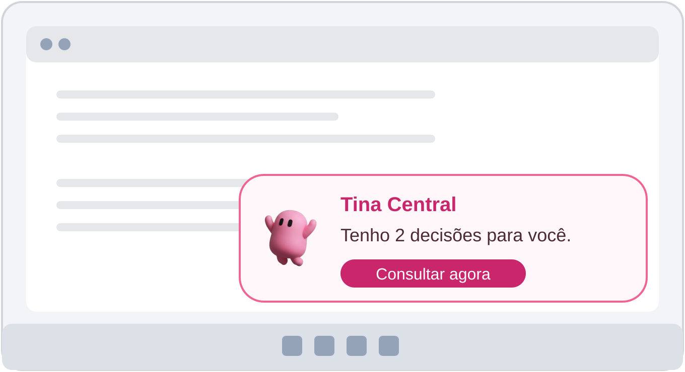

# Tina Mini — conceito de interface

**Status:** proposta visual aprovada como referência, não funcionalidade implementada.

A Tina Mini é um painel flutuante opcional no Windows que apresenta atividades concluídas, decisões pendentes e alertas relevantes. O exemplo acima contém dados fictícios. A mascote é o PNG oficial de `src-frontend/static/tina.png`, incorporado sem redesenho ou alteração de proporção. O restante é SVG.

## Diretrizes de implementação futura

- Respeitar a identidade visual de [BRAND-GUIDE.md](BRAND-GUIDE.md) e os componentes existentes.
- Painel opcional, recolhível e reposicionável; respeitar foco, escala de tela, múltiplos monitores e preferências de movimento.
- Abrir a conversa ou aprovação correspondente no app autenticado; não executar operações sensíveis diretamente pelo painel.
- Exibir apenas estados reais; não mostrar conteúdo privado, segredos ou detalhes sensíveis em notificações ou na tela bloqueada.
- Reutilizar eventos Tauri, permissões e caixa de atenção, sem criar outro agendador. Referências: issues #23, #30, #35, #36 e #40.
- Inspiração conceitual: dock e painel compacto do OpenBot (Nightly Labs); nenhum código ou asset externo incorporado.

## Aceite futuro

- [ ] Painel pode ser desativado e não rouba foco.
- [ ] Link abre contexto autorizado e reflete estado atual.
- [ ] Bloqueio de sessão oculta dados; nenhum conteúdo privado aparece.
- [ ] Testar DPI, múltiplos monitores, teclado, cancelamento e reinício no Windows.

Prioridade proposta: P2, após chat, aprovações e eventos persistentes.
